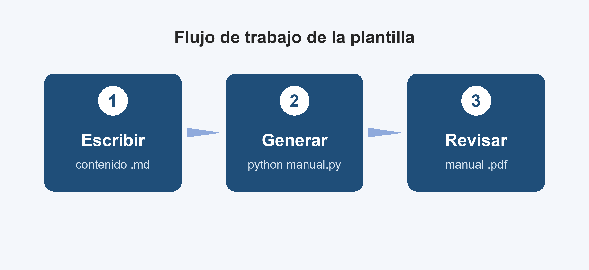

# Introducción

Esta plantilla convierte un archivo de texto en formato **Markdown** en un manual PDF con portada, índice, encabezados, pies de página con numeración y marcadores para navegar. Tú solo escribes el contenido; el diseño se aplica solo.

El manual que estás leyendo fue generado a partir del archivo `ejemplo.md`. Ábrelo junto a este PDF para ver cómo se escribe cada elemento.

## Para quién es

- Docentes que preparan guías, apuntes o manuales de laboratorio.
- Estudiantes que entregan informes con un formato uniforme.
- Cualquier persona que quiera un PDF ordenado sin pelear con un procesador de texto.

## Qué obtienes

| Elemento | Qué hace |
|---|---|
| Portada | Título, subtítulo, curso, autor, versión y fecha. |
| Índice | Se genera solo, con números de página reales. |
| Marcadores | Panel lateral del lector PDF para saltar entre capítulos. |
| Encabezado y pie | Título del manual, capítulo actual y "Página X de Y". |
| Archivo liviano | Usa fuentes estándar y reduce el peso de las imágenes. |

> [!CONSEJO]
> Copia `ejemplo.md`, cámbiale el nombre y reemplaza el contenido. Es la forma más rápida de empezar.

# Primeros pasos

## Requisitos

Necesitas Python 3 y la biblioteca ReportLab. Pillow es opcional, pero recomendable para reducir el peso de las imágenes.

```
pip install reportlab pillow
```

## Generar el PDF

Desde la carpeta de la plantilla, ejecuta:

```
python manual.py ejemplo.md
python manual.py mi_manual.md -o entregas/manual_final.pdf
```

El primer comando crea `ejemplo.pdf` al lado del archivo de origen. El segundo indica un nombre y una carpeta de salida.



## Datos de la portada

Al inicio del archivo, entre dos líneas `---`, van los datos del manual:

```
---
titulo: Manual de Laboratorio
subtitulo: Química General
autor: Nombre Apellido
curso: QUI-101
institucion: Facultad de Ciencias
version: 2.0
fecha: 10/11/2026
color: #7B2C2C
tamano: carta
indice: si
numerar: si
logo: imagenes/logo.png
---
```

> [!NOTA]
> Si no escribes la `fecha`, se usa la fecha del día. El `color` cambia la portada, los títulos, las tablas y las viñetas de una sola vez.

# Escribir el contenido

## Títulos

Usa `#` para capítulos, `##` para secciones y `###` para subsecciones. Cada capítulo empieza en una página nueva y todos aparecen en el índice.

### Ejemplo de subsección

Este es un título de tercer nivel. Sirve para dividir una sección larga en partes más pequeñas.

## Texto con formato

Puedes escribir en **negrita**, en *cursiva*, mostrar `código en línea` y agregar enlaces como [la documentación de ReportLab](https://docs.reportlab.com). Una línea en blanco separa un párrafo del siguiente.

## Listas

Lista con viñetas:

- Primer elemento.
- Segundo elemento, con **negrita** dentro.
- Tercer elemento.

Lista numerada:

1. Abre el archivo `.md` en tu editor.
2. Escribe o pega el contenido.
3. Ejecuta `python manual.py` y revisa el resultado.

## Tablas

Las tablas se escriben con barras verticales. La primera fila es el encabezado:

```
| Comando | Resultado |
|---|---|
| python manual.py a.md | Crea a.pdf |
```

| Comando | Resultado |
|---|---|
| `python manual.py a.md` | Crea `a.pdf` en la misma carpeta. |
| `python manual.py a.md -o b.pdf` | Crea `b.pdf` con el nombre indicado. |
| `python manual.py --help` | Muestra la ayuda. |

## Cuadros destacados

Empieza una cita con `> [!TIPO]` para crear un cuadro de color. Los tipos disponibles son NOTA, CONSEJO, ADVERTENCIA, IMPORTANTE y EJERCICIO. Puedes poner un título propio después del tipo.

> [!ADVERTENCIA]
> Guarda el archivo `.md` con codificación UTF-8 para que las tildes y la ñ se vean bien.

> [!IMPORTANTE] Antes de entregar
> Revisa el índice: si un título no aparece, probablemente le falta el espacio después de `#`.

> [!EJERCICIO] Ejercicio 1
> Cambia el `color` de este ejemplo a `#2E8B57`, vuelve a generar el PDF y observa qué partes cambian.

> Una cita sin tipo se muestra en cursiva, con una línea gris a la izquierda.

## Bloques de código

Encierra el código entre tres comillas invertidas. Los bloques largos continúan en la página siguiente y las líneas muy largas se cortan solas.

```
def promedio(notas):
    """Calcula el promedio de una lista de notas."""
    if not notas:
        return 0
    return sum(notas) / len(notas)

print(promedio([6.5, 5.8, 7.0]))
```

## Imágenes

Escribe la imagen sola en una línea: ``. La ruta es relativa al archivo `.md`. La imagen se ajusta al ancho de la página y el texto entre corchetes aparece como pie de figura.

## Saltos de página

Escribe `\salto` en una línea sola para forzar una página nueva.

# Archivos livianos y fáciles de leer

## Por qué importa el peso

Un PDF liviano se envía por correo, se sube a plataformas de cursos y se abre rápido en el celular. También es más fácil de procesar por herramientas de lectura y por asistentes de IA como Claude.

## Qué hace la plantilla

1. **Texto real, no imágenes.** Todo el texto se puede seleccionar, buscar y copiar.
2. **Fuentes estándar.** Usa Helvetica y Courier, que no se incrustan y no suman peso.
3. **Compresión de páginas.** El contenido de cada página se guarda comprimido.
4. **Imágenes ajustadas.** Con Pillow, las imágenes se reducen a 150 ppp para su tamaño en la página. Puedes cambiarlo con `dpi_imagenes`.
5. **Metadatos y marcadores.** El PDF incluye título, autor, idioma y un árbol de marcadores.

> [!CONSEJO]
> Para imprimir con muy buena calidad, usa `dpi_imagenes: 300`. Para enviar por correo, `dpi_imagenes: 110` reduce aún más el archivo.

## Lista de revisión final

- La portada tiene título, curso y versión correctos.
- El índice muestra todos los capítulos.
- Las imágenes se ven nítidas y tienen pie de figura.
- El archivo pesa lo esperado (el tamaño se muestra al generar).
